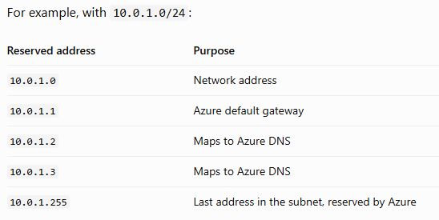
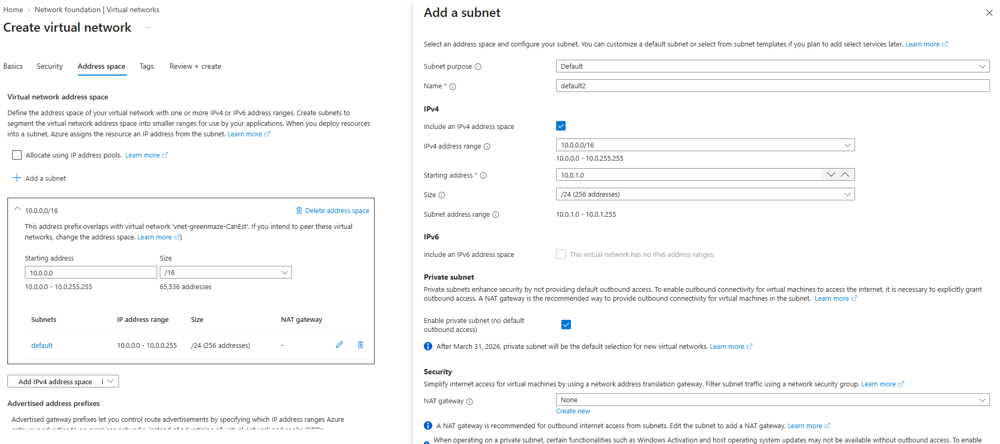
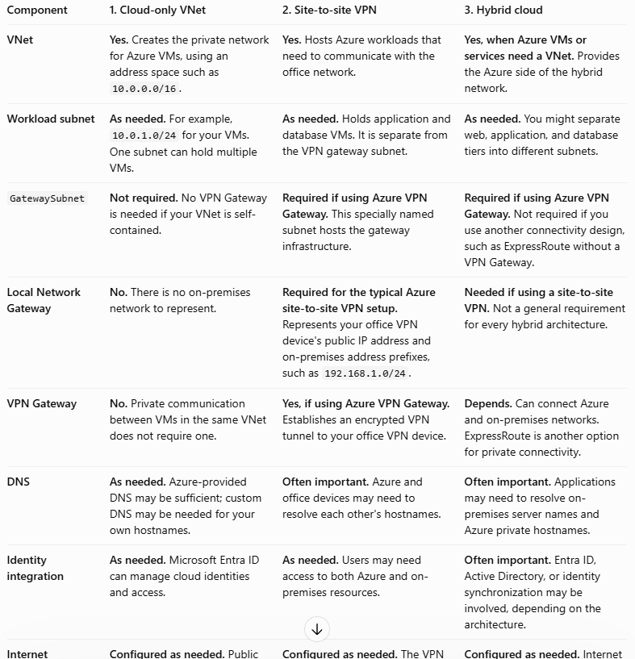
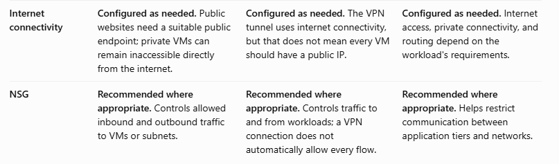
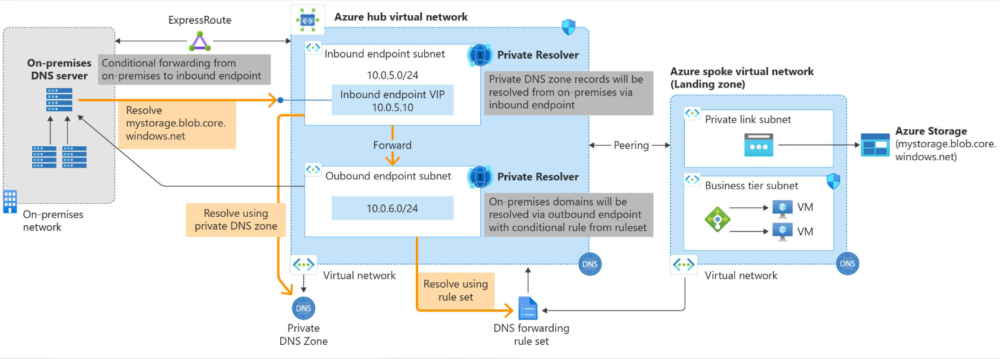
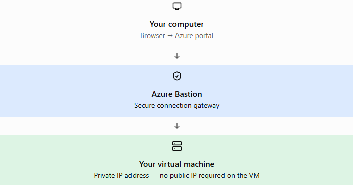
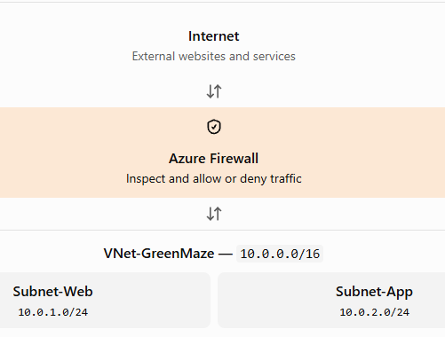

## Virtual networks (VNet) and subnets  
An Azure Virtual Network (VNet) is a logically isolated network in Azure where you place resources such as virtual machines and private endpoints. Think of it like your company's internal network, but configured in Azure.  

The VNet address space is divided into smaller networks called subnets. Subnets help organize resources and apply network controls. Subnet is a smaller IP address range inside the VNet.  
CIDR prefixes  

CIDR   total Ip address  
/32  1  
/31  2  
/30  4  
/29  8  
/28  16  
/27  32  
/26  64  
/25  128  
/24  256  

Azure reserves five IP addresses in every subnet, so a /24 provides 251 usable addresses.  

Remember: a smaller prefix number means a larger network. For example, /16 contains more addresses than /24.  

The smallest supported IPv4 subnet is /29. It means Azure supports IPv4 subnet sizes from /29 up to larger ranges such as /28, /27, /24, and /16 (among other prefixes).  

10.0.1.0/24 covers addresses from 10.0.1.0 to 10.0.1.255. In a standard Azure subnet, 5 addresses are reserved by the platform. Azure-reserved addresses: first 4 and last 1  
  
First 4 + last 1 = 5 reserved IPv4 addresses per subnet.

### Creating a VNet in the portal
1. Search for Virtual networks in the Azure portal.
2. Select Create.
3. Select your subscription and resource group.
4. Enter VNet-GreenMaze as the name.
5. Choose a region.
6. Configure an address space, such as 10.0.0.0/16.
7. Create subnets, such as 10.0.1.0/24 and 10.0.2.0/24.
8. Review and create.

  

https://learn.microsoft.com/en-us/azure/virtual-network/quickstart-create-virtual-network?utm_source=chatgpt.com&tabs=portal  

  
  

### Subnet 
A virtual network can be segmented into one or more subnets.  
Subnets provide logical division within your network.  
Subnets can help improve security, increase performance, and make it easier to manage the network.  
Each subnet must have a unique address range - cannot overlap with other subnets in the vnet in the subscription. 

### Reserved addresses 

For each subnet, Azure reserves five IP addresses. The first four addresses and the last address are reserved.
Let's examine the reserved addresses in an IP address range of 192.168.1.0/24.

192.168.1.0	This value identifies the virtual network address.  
192.168.1.1	Azure configures this address as the default gateway.  
192.168.1.2 and 192.168.1.3	Azure maps these Azure DNS IP addresses to the virtual network space.  
192.168.1.255	This value supplies the virtual network broadcast address.  

## IP Address
Static IP addresses don't change and are best for certain situations, such as:  
DNS name resolution, where a change in the IP address requires updating host records.  
IP address-based security models that require apps or services to have a static IP address.  
TLS/SSL certificates linked to an IP address.  
Firewall rules that allow or deny traffic by using IP address ranges.  
Role-based virtual machines such as Domain Controllers and DNS servers.   

### Networking foundation: Core connectivity for your resources in Azure - Virtual Network

## Az private link
Azure Private Link allows you to access Azure services privately through a private IP address inside your Virtual Network (VNet). Instead of accessing an Azure service through its public endpoint, you access it through a private endpoint in your VNet. You no longer need to expose your service to the public internet. 
- Private Link = private IP to access an Azure service.  
- Service Endpoint = subnet-based access restriction, but the service retains its public endpoint.  

## Virtual network

Azure Virtual Network (VNet) is the fundamental building block for your private network in Azure. Use VNets to:  
Deploy virtual machines and several other types of Azure resources to a virtual network, such as Azure App Service Environments, Azure Kubernetes Service (AKS), and Azure Virtual Machine Scale Sets.  

Communicate between each other: Connect virtual networks to each other, enabling resources in either virtual network to communicate with each other, by using virtual network peering or Azure Virtual Network Manager. The virtual networks you connect can be in the same, or different, Azure regions. a VNet is like a separate private company network. By default, two separate VNets do not automatically communicate just because they belong to the same Azure subscription.  

Communicate to the internet: All resources in a virtual network can communicate outbound to the internet, by default. You can communicate inbound to a resource by assigning a public IP address or a public Load Balancer. You can also use Public IP addresses or a public Load Balancer to manage your outbound connections.  

Communicate with on-premises networks: Connect your on-premises computers and networks to a virtual network by using VPN Gateway or ExpressRoute.  

Encrypt traffic between resources: Use Virtual network encryption to encrypt traffic between resources in a virtual network.  

## Azure DNS

Azure DNS provides DNS hosting and resolution by using the Microsoft Azure infrastructure. Azure DNS consists of three services:  
DNS (Domain Name System) translates domain names into IP addresses.  

Azure Public DNS is a hosting service for DNS domains. By hosting your domains in Azure, you can manage your DNS records by using the same credentials, APIs, tools, and billing as your other Azure services.  

Azure Private DNS is a DNS service for your virtual networks. Azure Private DNS manages and resolves domain names in the virtual network without configuring a custom DNS solution. Think of it as: DNS for your private Azure network.  

Azure DNS Private Resolver allows Azure and on-premises networks to resolve private DNS names across network boundaries without deploying and maintaining your own DNS servers. Think of it as a bridge between your on-premises DNS and Azure Private DNS.  
Why do we need it?  
Imagine your GreenMaze environment:  
- Your Azure VNet is 10.0.0.0/16.  
- Your Azure VM-Web has private IP 10.0.1.4.  
- Your Azure VM-DB has private IP 10.0.1.5.  
- Your company office has its own DNS server.  

You create an Azure Private DNS zone: greenmaze.local  
With records:  
Hostname	Private IP  
web.greenmaze.local	10.0.1.4  
db.greenmaze.local	10.0.1.5  
 
Azure VMs linked to this private DNS zone can resolve those names.   
But what if a computer in your Montreal office needs to resolve db.greenmaze.local?    
Your on-premises DNS server doesn't automatically know about Azure Private DNS zones. This is where Azure DNS Private Resolver helps.  

  

Inbound endpoint  
- Allows DNS queries to come into Azure from on-premises networks.  
- Your on-premises DNS server forwards queries for Azure private DNS names to the inbound endpoint's private IP.  
- Azure resolves the name using the linked Private DNS zone.  
Example: Montreal PC → On-prem DNS → Azure DNS Private Resolver inbound endpoint → Azure Private DNS  

Outbound endpoint  
- Allows DNS queries to go out of Azure to external DNS servers, such as your company's on-premises DNS.  
- Azure DNS forwarding rules tell Azure where to send queries for specific domains.  
Example: Azure VM → Azure DNS Private Resolver outbound endpoint → On-prem DNS server  

Remember the direction:  
Inbound On-premises asks Azure  

Outbound Azure asks on-premises  

## Azure Bastion, Route server, NAT Gatewat, and Traffic Manager.

### Load balancing and content delivery: Manage, distribute, and optimize your applications and workload.
## Load Balance, Application Gateway, Route Server, NAT Gateway, and Traffic Manager.

### Hybrid connectivity: Secure communication to and from your resources in Azure
## VPN Gateway, ExpressRoute, Virtual WAN, and Peering Service.

### Network security: Protect your web app and IaaS seviceces from DDos attacks and malicous actors.
## Firewall manager, Firewall, Web application Firewal, and DDos protection

### Network management and monitoring: Manage and monitor your network resources.
## Network Watcher, Az Monitor, and Az virtual Network Manager.

### Container networking: Enhanced security and observability for containerized workloads on AZ Kubernetes Service (AKS)
## Container network security and Container network observability.

### Azure Bastion
Azure Bastion is a managed Azure service that lets you securely connect to a virtual machine (VM) using RDP (Windows) or SSH (Linux) through the Azure portal, without exposing the VM's public IP address.  
  
Think of it as a secure remote-access gateway into your Azure network.  

## Why use Azure Bastion?  
- More secure: You don't need to expose your VM to the internet with a public IP.  
- Easy access: Connect to Windows or Linux VMs directly from your browser.  
- No client installation: Browser-based RDP/SSH works through the Azure portal.   

Deployments cost money for every hour they exist, even when you're not connected. The Bastion Developer option is free, but has limitations and is available only in supported regions.  
One important networking detail: dedicated Bastion deployments require a separate subnet named AzureBastionSubnet with a /26 or larger address range. You cannot use your ordinary application subnet for Bastion.  

## Azure Firewall
Azure Firewall is a managed, cloud-based network security service that controls traffic entering, leaving, and moving between Azure networks according to rules you configure.  

Think of it as a central security guard for your Azure network.  

You just learned about Azure Bastion. The key difference is:  
- Azure Bastion lets an administrator securely connect to a VM.  
- Azure Firewall filters network traffic to help protect your resources.  
1. How Azure Firewall works  
Imagine your GreenMaze VNet contains two subnets:  

   

For example, you could configure a firewall rule to allow your VM to access approved websites while blocking connections to other destinations. To make traffic follow the firewall, you may also need to configure Azure routes.  

Azure Firewall is stateful: it tracks connections and automatically allows the return traffic for permitted connections.  

### Azure Firewall vs. NSG vs. Bastion 
These three services have different purposes.  

Network Security Group (NSG): Filter traffic to and from network interfaces or subnets using IPs, ports, and protocols. An NSG contains inbound and outbound security rules. Each rule can specify a source, destination, port, protocol, and whether to allow or deny the traffic. NSGs are stateful, meaning return traffic for an allowed connection is automatically permitted.  

Azure Firewall: Centralize traffic inspection and filtering across networks, with application-aware rules and additional threat protection.  

Azure Bastion: Securely connect administrators to VMs over RDP or SSH through the Azure portal.  

An NSG is usually sufficient for basic subnet and VM traffic control. Azure Firewall is useful when you need centralized rules across multiple subnets or VNets.  

An important distinction: creating a VNet and subnets does not automatically isolate the subnets from each other. You use NSGs and other network controls to enforce the security boundaries you need.

Azure DDoS Network Protection  

### Address spaces, CIDR, subnetting, and VNet design.
An Azure virtual network is a logical isolation of the Azure cloud resources.  

You can use virtual networks to provision and manage virtual private networks (VPNs) in Azure.  

You control the DNS server settings for virtual networks, and segmentation of the virtual network into subnets.  

Each virtual network has its own Classless Inter-Domain Routing (CIDR) block and can be linked to other virtual networks and on-premises networks.  

You can link virtual networks with an on-premises IT infrastructure to create hybrid or cross-premises solutions, when the CIDR blocks of the connecting networks don't overlap.

## Network connectivity

### VNet peering, VPN Gateway, ExpressRoute, and service endpoints.

## Vnet service endpoints
The key idea: You can restrict access to an Azure service so that only selected VNets can access it.  
A service endpoint allows a selected subnet in your VNet to access a supported Azure service, while allowing you to restrict that service's network access to authorized VNets/subnets.  

Important details:  
1. You enable the service endpoint on a subnet, not directly on an individual VM.  
2. You configure the Azure service's firewall to allow that subnet.  
3. Every VM in that authorized subnet can potentially access the service, subject to other security controls and permissions.  
4. You still need the correct Azure permissions (for example, Storage data-plane RBAC permissions).  

Service Endpoint: Restricts an Azure service's network access to selected VNets/subnets.  
Private Endpoint: Gives an Azure service a private IP address inside your VNet.  

## Network security

### Network Security Groups (NSGs), application security groups, and Azure Firewall basics.

## DNS and traffic routing

### Azure DNS, private DNS zones, route tables, and effective routes.

## Network troubleshooting

### Network Watcher, connection troubleshoot, IP flow verify, and packet capture.