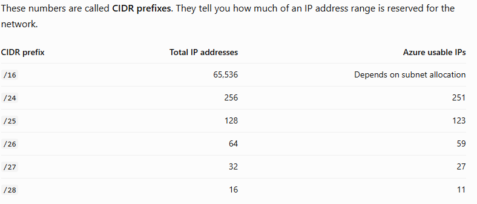

## Virtual networks (VNet) and subnets  
An Azure Virtual Network (VNet) is a logically isolated network in Azure where you place resources such as virtual machines and private endpoints. Think of it like your company's internal network, but configured in Azure.  

The VNet address space is divided into smaller networks called subnets. Subnets help organize resources and apply network controls. Subnet is a smaller IP address range inside the VNet.  
CIDR prefixes  

Azure reserves five IP addresses in every subnet, so a /24 provides 251 usable addresses.

Remember: a smaller prefix number means a larger network. For example, /16 contains more addresses than /24.

### Creating a VNet in the portal
1. Search for Virtual networks in the Azure portal.
2. Select Create.
3. Select your subscription and resource group.
4. Enter VNet-GreenMaze as the name.
5. Choose a region.
6. Configure an address space, such as 10.0.0.0/16.
7. Create subnets, such as 10.0.1.0/24 and 10.0.2.0/24.
8. Review and create.
### Address spaces, CIDR, subnetting, and VNet design.

## Network connectivity

### VNet peering, VPN Gateway, ExpressRoute, and service endpoints.

## Network security

### Network Security Groups (NSGs), application security groups, and Azure Firewall basics.

## DNS and traffic routing

### Azure DNS, private DNS zones, route tables, and effective routes.

## Network troubleshooting
### Network Watcher, connection troubleshoot, IP flow verify, and packet capture.