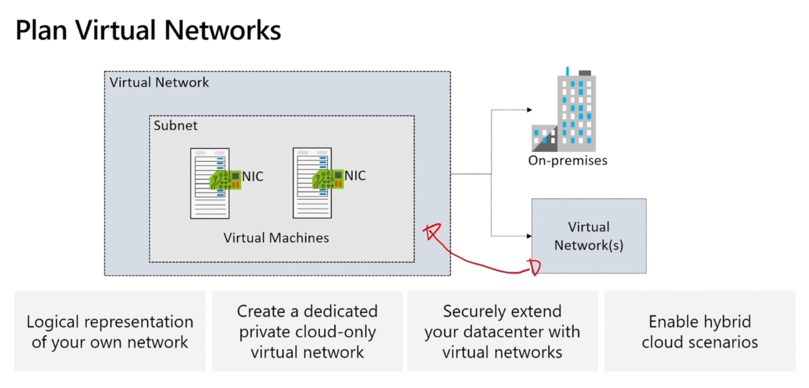
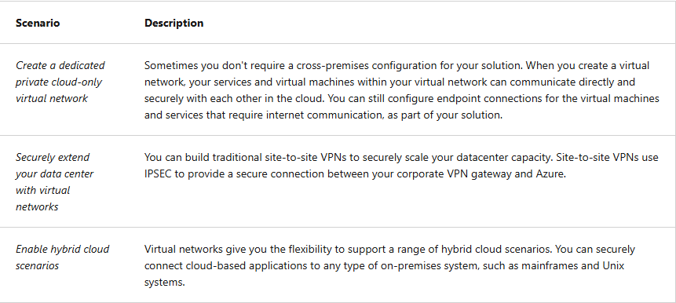
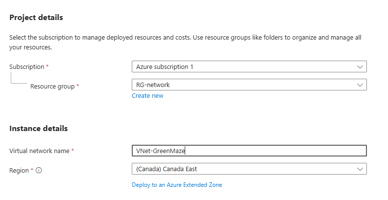
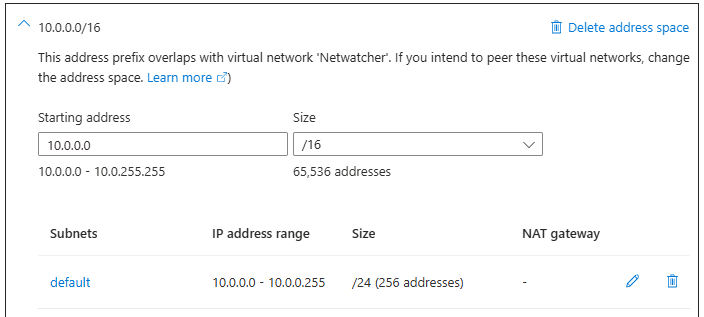
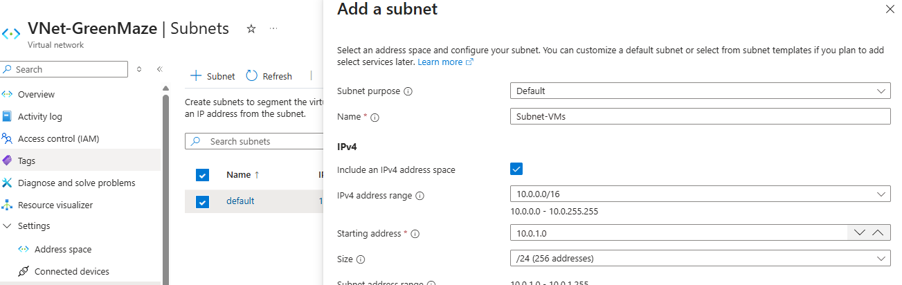

### Plan virtual network

   

## Things to consider when using virtual networks
  

These three scenarios explain why you would create an Azure Virtual Network (VNet) and how it can connect cloud resources to each other, the internet, or your company's on-premises network.

Think of an Azure VNet as a private network in the cloud, similar to the LAN in your office.  

## 1. Create a dedicated private cloud-only virtual network
Example: Imagine you're building a test environment for your GreenMaze AZ-104 lab.  
- You create a VNet called VNet-GreenMaze.  
- Address space: 10.0.0.0/16.  
- You create a subnet for your virtual machines.  
- Two VMs communicate over the VNet's private IP addresses.  
- You configure internet access only for resources that need it.  

  

  

   

Why do we use 10.0.1.0/24?  
Your VNet is 10.0.0.0/16, which covers a large range of private IP addresses. The subnet 10.0.1.0/24 reserves a smaller block inside it.  
- 10.0.1.0 — subnet network address.  
- 10.0.1.1 through 10.0.1.254 — 254 addresses in the subnet; Azure reserves five addresses, leaving 251 for other allocations.  
- 10.0.1.255 — broadcast address in conventional IPv4 subnetting; Azure reserves this address too.  
AZ-104 exam tip: Azure reserves five IP addresses in every IPv4 subnet.  
10.0.1.0 — network address  
10.0.1.1 — Azure-reserved  
10.0.1.2 — Azure-reserved  
10.0.1.3 — Azure-reserved  
10.0.1.4 through 10.0.1.254 — 251 addresses available for allocation  
10.0.1.255 — Azure-reserved   

A /24 has 256 total addresses, so \(256-5=251\) are available for Azure resources.  
The VMs can communicate privately, subject to network security groups (NSGs), routes, firewalls, and other controls.  

Important: A VNet does not automatically give every VM internet access, and a private IP address alone does not make a resource secure. Internet connectivity depends on the network configuration.  

When would you use this? Development environments, application testing, cloud-hosted services, or workloads that don't need to communicate with an on-premises data center.  

Step 2 — Create your first VM
In the Azure portal:
1. Search for Virtual machines.
2. Click + Create → Azure virtual machine.
3. On the Basics tab, enter:  

Virtual machine name: VM-GreenMaze-01  
Region: Canada East  
Image: Ubuntu Server LTS  
Size: A small supported size suitable for a lab  
Authentication type: SSH public key  
Username: azureuser  

Choose your existing subscription and resource group.  
  Step 3 — Connect the VM to your subnet
On the Networking tab, configure:
Setting	Value
Virtual network	VNet-GreenMaze
Subnet	Subnet-VMs (10.0.1.0/24)
Public IP	None
NIC network security group	Basic, if offered
Public inbound ports	None

Keep the VM private. You can use Azure Bastion or another configured private management method later to access it.

Click Review + create, then Create.
Step 4 — Create your second VM
Repeat the process with these changes:
Setting	Value
VM name	VM-GreenMaze-02
Virtual network	VNet-GreenMaze
Subnet	Subnet-VMs
Public IP	None

Both VMs must be connected to the same VNet and subnet for this exercise.
Step 5 — Verify private connectivity
Once both VMs are deployed:
1. Open each VM in the Azure portal.
2. Go to its Networking page or network interface.
3. Record both private IP addresses.
For example:
- VM1: 10.0.1.4
- VM2: 10.0.1.5
These are examples; Azure may assign different addresses.

When you have a secure way to connect to VM1, you can test VM2's private address from VM1:
ping 10.0.1.5

Replace that example IP with VM2's actual address. Ping may fail if the operating system firewall blocks ICMP, even when the VNet is working correctly.
Step 6 — Configure internet access only if needed
You don't need to configure internet access just to let the two VMs communicate privately.

If your VMs need outbound internet access for updates or downloads, you can configure an appropriate method such as an Azure NAT Gateway or Azure Firewall. A NAT Gateway allows outbound connectivity without assigning public IP addresses to the VMs, but it has a cost.

