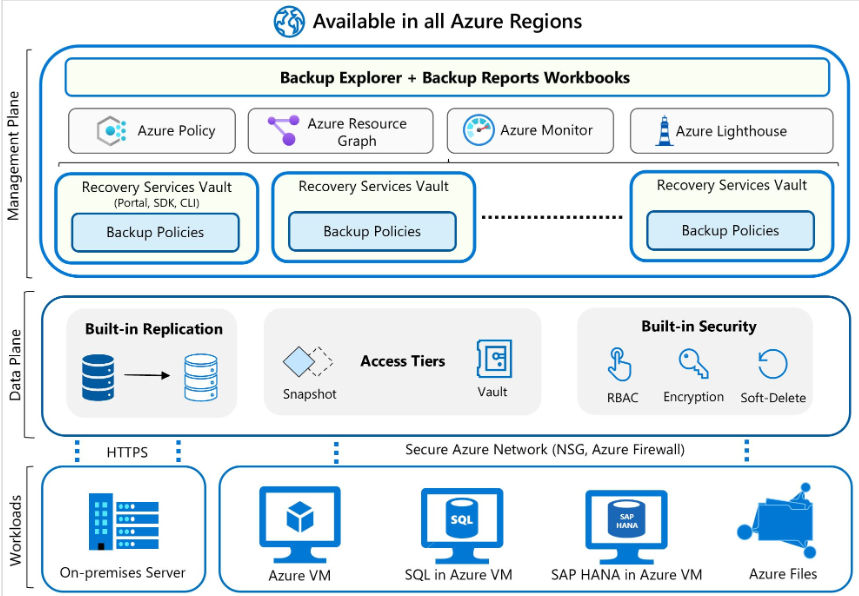
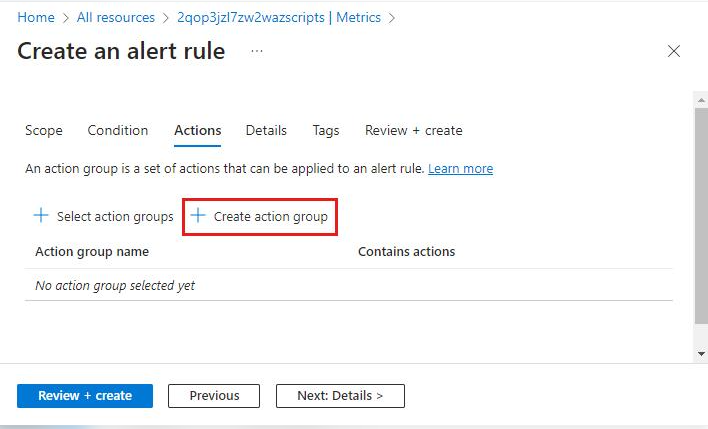
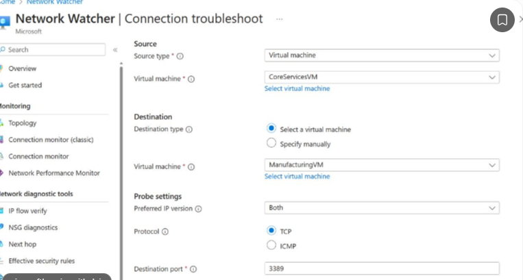
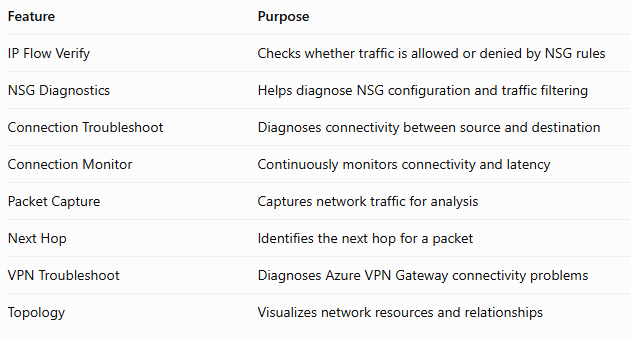
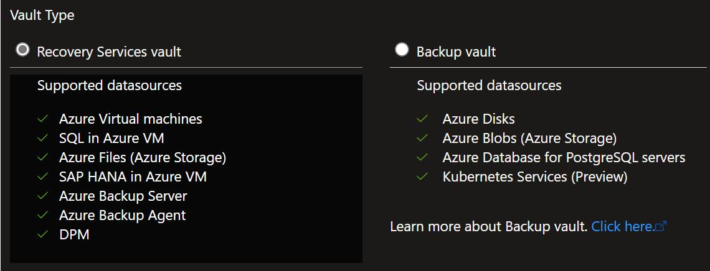
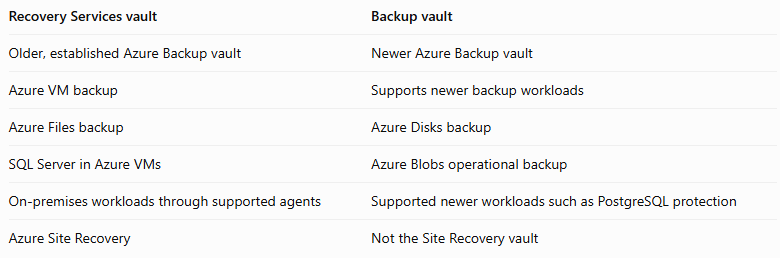
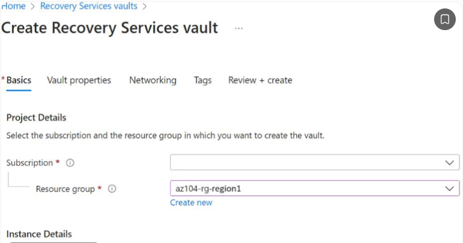
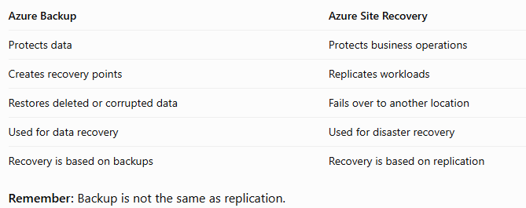
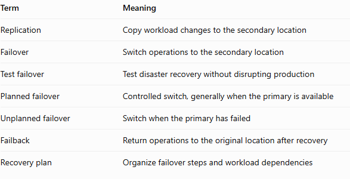
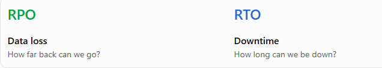

# What is Azure Backup?
The Azure Backup service provides simple, secure, and cost-effective solutions to back up your data and recover it from the Microsoft Azure cloud.
  

  

# Azure Monitor is the central monitoring service in Azure.  

The four important components
``` text
**Component	    Purpose**
Metrics	        Numerical measurements
Logs	        Detailed records and events
Alerts	        Notify you when something happens
Dashboards	    Visualize monitoring information
```
Azure Monitor Metrics
Metrics are numerical values collected at regular intervals.  
Azure Portal → Monitor → Metrics  

You can also access them through an individual resource:  
Virtual Machine → Monitoring → Metrics.  

Log Analytics workspace is where you collect and analyze log data. Think of it as a centralized database for monitoring information. Instead of checking 70 different virtual machines individually, you can send their logs to one workspace.  

### Important tables
**Table	What it contains**

``` text
Heartbeat	    Records showing that an agent is communicating
Syslog	        Linux system logs
Event	        Windows event logs
SecurityEvent	Windows security events
Perf	        Performance counters
AzureActivity	Azure subscription management activity
```

Note: Some tables require the appropriate diagnostic settings, agent, data collection rule or connector configuration before data appears.  

Azure Monitor Logs / Log Analytics can cost money, but the cost depends on how much data you collect and how long you retain it.  

What is KQL? Kusto Query Language is used to query log data.  

Azure Monitor Agent (AMA) sends heartbeat data to a Log Analytics workspace through a Data Collection Rule (DCR).  
  

examples:  
Someone deletes a VM → Activity Log.  
Someone accesses a storage account → Resource Logs, if the relevant logging is enabled.  
VM CPU reaches 90% → Metric.  

Azure Monitor Alerts  

  
Alerts notify administrators when a specific condition is met.


### Metric alerts
Monitor numerical values.  

Examples:  
- CPU exceeds 85%.  
- Disk queue length becomes too high.  
- Network traffic exceeds a threshold.  

### Log search alerts
Can un a KQL query periodically and trigger an alert when the query meets a specified condition.You want to be notified when more than 10 failed logins occur within 5 minutes.
You can query the relevant security logs and configure a log search alert.
Best for: Events and patterns that require querying logs.

### Activity Log alerts
Monitor Azure subscription-level activities.  
example:  
Someone deletes a virtual machine.  
Someone deletes a network security group.  
A resource is created.  
An administrative operation fails.  

### Action Groups 
An Action Group defines what happens when an alert fires.  
Possible actions include:Send email. Send SMS. Make a phone call. Trigger a webhook. Trigger an Azure Function. Trigger an Automation Runbook. Send notifications to supported ITSM integrations.

### Alert Processing Rules
These are different from Action Groups. Alert Processing Rules allow you to modify how alerts are handled.  
For example:  
- Suppress notifications during maintenance.  
- Suppress alerts for specific resources.  
- Add or remove action groups.  
- Apply rules to specific resource groups or subscriptions.  

**Remember:**  
- Alert rule = Detect the problem.  
- Action group = Perform the action.  
- Alert processing rule = Control how alerts are processed.  

VM Insights: Monitors virtual machines, including performance, dependencies and health information. Useful for identifying CPU, memory, disk and performance problems.  

Storage Insights: Provides monitoring information for storage accounts, including capacity, transactions and availability.  

Network Insights: Helps monitor network resources, connectivity and network health.  

VM Insights and Dependency Mapping: VM Insights can help you understand dependencies between machines and their network connections.

# Azure Network Watcher

  
Azure Network Watcher is particularly important.
It helps diagnose network connectivity issues in Azure.  


### IP Flow Verify
IP Flow Verify tells you whether the traffic is allowed or denied by the applicable NSG rules and identifies the rule responsible.

### Next Hop
You want to understand where Azure routes the traffic.  
It can identify:- Internet- Virtual network- Virtual network gateway- Virtual appliance  

IP Flow Verify = Is the traffic allowed?  
Next Hop = Where will the packet go?  
Connection Troubleshoot = Why can't these endpoints communicate?  
Connection Monitor = Is connectivity consistently healthy over time?  
Packet Capture = What packets are actually being transmitted?  

### on prem
For on-premises Windows machines, you can back up directly to Azure with the Azure Backup Microsoft Azure Recovery Services (MARS) agent. Alternatively, you can back up these Windows machines to a backup server, perhaps a System Center Data Protection Manager (DPM) or Microsoft Azure Backup Server (MABS). You can then back that server up to a Recovery Services vault in Azure.  

You can back up supported Azure VMs directly. By default, Azure Backup uses the Azure VM agent and a backup extension for application-consistent or file-system-consistent snapshots. If you only want to back up files and folders on a supported Windows Azure VM, you can use the MARS agent; MARS doesn't support Linux.  

Recovery Services vaults and Backup vaults manage backup policies, protected items, and recovery points for their supported workloads. Vaulted backup stores an isolated copy of protected data in Azure Backup-managed storage. Operational protection can instead retain data or snapshots in the customer's subscription without creating a vaulted copy.

### Access tiers
There are three access tiers where the backups can be stored:

Snapshot tier: Supported workloads, such as Azure VMs and Azure Files, can retain point-in-time snapshots for quick recovery. Azure VM backup snapshots are retained in the customer's subscription; Azure Files backup uses file-share snapshots. Azure Blob operational backup isn't snapshot-based: it uses native storage features such as point-in-time restore and versioning.    

Vault-standard tier: For supported workloads configured for vaulted backup, this tier stores an isolated copy of backup data in Azure Backup-managed storage. Supporting snapshots or   operational backup doesn't automatically mean that a workload has a vaulted copy as well.  

Archive tier: Customers rely on Azure Backup for storing backup data, including their Long-Term Retention (LTR) backup data, with retention needs defined in the organization's compliance rules. In most cases, the older backup data is rarely accessed and is only stored for compliance needs.

# Backup & Recovery
Azure Backup is Microsoft's backup service for protecting Azure and supported on-premises workloads.

What can Azure Backup protect? Azure Virtual Machines. Azure Files. SQL Server running in Azure VMs. On-premises Windows machines through the MARS agent. Workloads protected through DPM or Microsoft Azure Backup Server. Other supported workloads using the appropriate vault and protection configuration.

On supported Windows Azure VMs, the Microsoft Azure Recovery Services (MARS) agent can back up files and folders. System-state backup requires a Windows Server operating system supported for that feature in the MARS support matrix. MARS doesn't support Linux.  

### Recovery Services Vault vs Backup Vault
Azure has two important vault types.




Recovery Services vaults support Azure Site Recovery. Backup vaults do not replace Recovery Services vaults for Site Recovery.

Creating a Recovery Services Vault
Typical process:
1. Open Azure Portal.
2. Search for Recovery Services vaults.
3. Select Create.
4. Choose subscription.
5. Choose resource group.
6. Choose vault name.
7. Choose region.
8. Review and create.


**Important considerations**
A vault is a separate Azure resource.  
Its region is important for data protection and recovery planning.  
Backup redundancy options affect resilience.  
Vault access and security settings must be managed.   
A vault is not itself a backup policy.  

### Storage redundancy
Know these options:  
LRS: Copies data within one physical location in a region.  
ZRS: Replicates data across availability zones in a region.  
GRS: Replicates data to a secondary region.  


### Azure Backup Policies
A backup policy determines when backups occur and how long recovery points are retained.  

**Important policy components**
```text
**Setting**	            **Purpose**
Backup frequency	How often backups occur
Backup schedule	    When backups run
Retention	        How long recovery points are kept
Instant restore	    Provides short-term snapshot-based recovery, depending on workload
```

### VM backup policy types
- Standard policy.  
- Enhanced policy.  

They offer different scheduling and backup capabilities. Enhanced policies provide more   flexible scheduling and additional backup capabilities for supported VM configurations.  

### Operational vs Vault-Standard backup
Azure VM backup has different backup storage tiers and retention capabilities.  
Operational backup supports quick recovery using locally available snapshots.  
Vault-Standard backup stores recovery points in the backup vault's managed storage.  
Longer-term retention and stronger isolation are important reasons to use vault storage.  

## Soft Delete and Backup Security
This is a particularly important security topic. What happens if a malicious administrator deletes a backup?  
You do not want the backup to disappear immediately.  

**Soft Delete** retains deleted backup data for a recovery period, allowing recovery if the deletion was accidental or malicious.  


```text
Feature	                   Purpose  
Soft Delete	Protects      deleted backup data
Enhanced Soft Delete	  Provides additional protection controls for supported workloads
Immutability	          Prevents protected backup data from being modified or deleted during the immutability period
Multi-user authorization (MUA)	Adds approval protection for sensitive vault operations
Resource Guard	          Helps protect critical backup operations against unauthorized changes
```

### Backup and Restore Operations  
For an Azure VM:  
1. Open Recovery Services vault.  
2. Select Backup items.  
3. Select Azure Virtual Machine.  
4. Select the protected VM.  
5. Choose Restore VM.  
6. Select a recovery point.  
7. Choose the restoration configuration.  
8. Start the restore operation.  

**Types of VM restoration**  
```text
Restore option	              Purpose
Create new VM	            Restore as a separate virtual machine
Replace existing disks	    Restore disks to the existing VM's configuration
Restore disks	            Restore disks separately for manual configuration
```
The exact options depend on the protected workload and restore configuration.  


### Important: Restore vs Rebuild
Restore = Recover data or resources from a backup.  
Rebuild = Deploy a new resource and configure it again.  
Replication = Maintain a copy of a workload at another location.  
These are different recovery strategies.  

# Azure Site Recovery (ASR)
**Azure Site Recovery is a disaster recovery service.**
This is different from Azure Backup.  

Site Recovery helps you replicate workloads and perform failover to another region. 

**Backup vs Site Recovery**

A backup protects your data at specific recovery points. Replication keeps a copy of your workload updated at the secondary location.  

### Important Site Recovery terminology



## Recovery Point Objective (RPO) vs Recovery Time Objective (RTO)
RPO: How much data can we afford to lose? 

RTO: How long can the business afford to be unavailable?  

If a question talks about maximum acceptable data loss, think RPO. If it talks about maximum acceptable downtime, think RTO.  



### workbook
Azure Backup integrates with Log Analytics for monitoring and reporting and provides reports via Workbooks.  
Azure Backup provides in-built job monitoring for operations such as configuring backup, backing up, restoring, deleting backups, and so on. Azure Backup is scoped to the vault, making it ideal for monitoring a single vault.  

If you need to monitor operational activities at scale, Backup Explorer provides an aggregated view of your entire backup estate, enabling detailed drill-down analysis and troubleshooting. It's a built-in Azure Monitor workbook that provides a single, central location to help you monitor operational activities across the entire backup estate on Azure, spanning tenants, locations, subscriptions, resource groups, and vaults.

# WHAT TO MEMORIZE FOR THE EXAM

**If the question asks...               Think of...**
```text
Monitor CPU usage	                        Azure Monitor Metrics
Analyze detailed events	                    Log Analytics
Query log information	                    KQL
Send logs to another destination	        Diagnostic settings
Notify administrator of CPU threshold	    Metric alert
Detect failed logins using queries	        Log search alert
Detect VM deletion	                        Activity Log alert
Send an email when an alert fires	        Action Group
Suppress alerts during maintenance	        Alert Processing Rule
Determine whether an NSG allows traffic	    IP Flow Verify
Find the next network hop	                Next Hop
Continuously monitor network latency	    Connection Monitor
Capture packets	                            Packet Capture
Monitor VM performance and dependencies	     VM Insights
Monitor application exceptions	            Application Insights
Back up an Azure VM	                        Azure Backup
Manage Azure VM backup	                    Recovery Services vault
Protect supported newer backup workloads	Backup vault
Recover deleted backup data	                Soft Delete
Protect backup data from deletion	        Immutability
Replicate VMs to another region	            Site Recovery
Switch to secondary region	                Failover
Test disaster recovery	                    Test failover
Return to original region	                Failback
Maximum acceptable data loss	            RPO
Maximum acceptable downtime	                RTO
```


