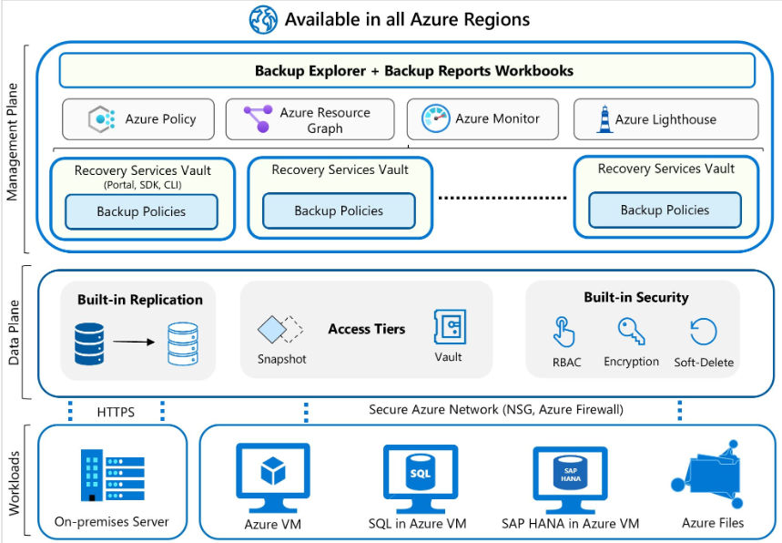

# What is Azure Backup?
The Azure Backup service provides simple, secure, and cost-effective solutions to back up your data and recover it from the Microsoft Azure cloud.
  

  

### Recovery Time Objective (RTO)
Recovery Time Objective (RTO) is the target time within which a business process must be restored after a disaster occurs to avoid unacceptable consequences. For instance, if a critical application goes down due to a server failure and the business can only tolerate a maximum of four hours of downtime, then the RTO is four hours.  

Recovery Point Objective (RPO) is the maximum amount of data loss, measured in time, that your organization can sustain during an event.  

### What data is backed up and how?
The simplest explanation of Azure Backup is that it backs up data, machine state, and workloads running on on-premises machines and VM instances to the Azure cloud. Azure Backup uses Recovery Services vaults and Backup vaults to manage protection; where backup data is stored depends on the workload and backup tier.

For on-premises Windows machines, you can back up directly to Azure with the Azure Backup Microsoft Azure Recovery Services (MARS) agent. Alternatively, you can back up these Windows machines to a backup server, perhaps a System Center Data Protection Manager (DPM) or Microsoft Azure Backup Server (MABS). You can then back that server up to a Recovery Services vault in Azure.

You can back up supported Azure VMs directly. By default, Azure Backup uses the Azure VM agent and a backup extension for application-consistent or file-system-consistent snapshots. If you only want to back up files and folders on a supported Windows Azure VM, you can use the MARS agent; MARS doesn't support Linux.

Recovery Services vaults and Backup vaults manage backup policies, protected items, and recovery points for their supported workloads. Vaulted backup stores an isolated copy of protected data in Azure Backup-managed storage. Operational protection can instead retain data or snapshots in the customer's subscription without creating a vaulted copy.

### Supported backup types
Backup types depend on the workload. Azure VM backup uses an initial full backup followed by incremental backups that transfer changed blocks. DPM/MABS use incremental backups for disk backups and backups to Azure. Workload-aware SQL Server backup in Azure VMs instead uses the full, differential, and transaction log backup types described next.

Azure Backup supports the following SQL Server database backup types:

  

Understand the main compute services
Compute means the processing power and resources used to run applications, operating systems, and workloads in Azure.

There are several ways to deploy workloads:
Azure service	What it does
Azure Virtual Machines	Runs Windows or Linux servers
Virtual Machine Scale Sets	Manages groups of identical VMs that can scale
Azure App Service	Hosts web applications without managing the OS
Azure Container Instances	Runs containers without managing servers
Azure Kubernetes Service (AKS)	Manages containerized applications at scale
Azure Functions	Runs code in response to events

2. Azure Virtual Machines (VMs)
An Azure VM is essentially a computer running inside Microsoft's datacenter.

For example, imagine InVeris needs a Windows Server to host an internal application.

You can deploy a VM with:
- Windows Server or Linux.
- CPU and RAM.
- Operating system disk.
- Additional data disks.
- Network interface card (NIC).
- Private or public IP address.
Important AZ-104 concepts:
- VM sizes: Determine CPU, RAM, and performance.
- Availability Zones: Protect against datacenter-level failures.
- Availability Sets: Protect against certain hardware and maintenance failures.
- Managed Disks: Azure-managed storage for VM disks.
- VM extensions: Install software or configure a VM after deployment.
- Custom Script Extension: Run scripts inside a VM.

3. VM Scale Sets (VMSS)
Imagine your company hosts a website.

Normally, you have two VMs running the application.

Suddenly, traffic increases dramatically.

A VM Scale Set can automatically increase the number of VMs to handle the workload.

For example:
- Normal traffic: 2 VMs.
- High traffic: 5 VMs.
- Traffic decreases: Back to 2 VMs.
This is called Autoscaling.

4. Azure App Service
Azure App Service lets you host websites and web applications without managing the underlying Windows or Linux server.

For example:
- Hosting a company website.
- Running an internal web application.
- Hosting an API.
You manage the application; Azure manages much of the underlying infrastructure.

Important concepts:
- App Service Plan: Defines compute resources, pricing tier, and scaling.
- Deployment slots: Test a new version before switching production traffic.
- Autoscaling: Increase resources or instances based on workload.
- Custom domains and TLS certificates.

5. Azure Containers
Containers package an application together with its dependencies so it can run consistently across environments.

Think of a container as a lightweight, isolated environment for running an application.

There are two important Azure services:

Azure Container Instances (ACI)

Runs containers without requiring you to create or manage virtual machines.

Example: Run a small application or temporary workload.

Azure Kubernetes Service (AKS)

Manages containerized applications across a cluster of machines.

Example: A company runs hundreds of containers and needs orchestration, scaling, and management.

Remember for the exam:
- ACI = Simple container deployment.
- AKS = Container orchestration and management.
- Azure Container Registry (ACR) = Stores container images.

6. Azure Functions
zure Functions is a serverless compute service.

Serverless does not mean there are no servers. It means Azure manages the infrastructure for you.

Example:

Imagine someone uploads a file to Azure Blob Storage.

You want Azure to automatically run a script that processes the file.

Azure Functions can execute that code when the upload happens.

Common triggers include:
- HTTP requests.
- Timer schedules.
- Queue messages.
- Blob Storage events.
Remember: Azure Functions = Run code when something happens, without managing a server.

7. Deploying and managing virtual machines
This is particularly important for AZ-104.
You should understand the VM lifecycle:

slideshare.net

1. Create a resource group.
2. Create a virtual network and subnet.
3. Select a VM image (Windows or Linux).
4. Choose the VM size.
5. Configure authentication.
6. Configure networking.
7. Select OS and data disks.
8. Review and deploy.
After deployment, you should know how to:
Operation	Purpose
Start	Power on a VM
Stop	Shut down the VM
Restart	Reboot the VM
Redeploy	Move the VM to another Azure host
Resize	Change CPU/RAM capacity
Capture	Create an image from a VM
Delete	Remove the VM resource

Important distinction:

Stop vs. Stop (deallocate)
- Stop: The VM is powered off, but compute resources may remain allocated and billed.
- Stop (deallocate): Azure releases the compute allocation. You generally stop paying VM compute charges, but storage charges remain.

8. Infrastructure as Code (IaC)
Azure allows you to deploy resources using templates instead of manually creating everything through the portal.

Two important technologies:
- ARM templates: Azure Resource Manager deployment templates written in JSON.
- Bicep: A simpler declarative language that compiles into ARM templates.
Example:

Instead of manually creating 10 virtual machines, you can define the configuration in a template and deploy them consistently.

PowerShell and Azure CLI are also important administration tools.

1. Automate deployments with ARM and Bicep
- Understand ARM template JSON structure.
- Understand Bicep syntax and resources.
- Modify existing templates.
- Deploy resources using templates.
- Export existing deployments as ARM templates.
- Convert ARM templates to Bicep.
2. Create and configure virtual machines
- Create Windows and Linux VMs.
- Select VM sizes and images.
- Configure encryption at host.
- Move VMs between resource groups, subscriptions, and regions.
- Manage VM sizes.
- Attach, detach, and manage VM disks.
- Understand Availability Sets and Availability Zones.
- Configure VM Scale Sets.
3. Provision and manage containers
- Create and manage Azure Container Registry (ACR).
- Deploy Azure Container Instances (ACI).
- Deploy Azure Container Apps.
- Configure container sizing.
- Configure container scaling.
Important correction: Azure Container Apps is explicitly in the current exam objectives. It was missing from my initial introduction.
4. Create and configure Azure App Service
- Create App Service Plans.
- Understand pricing tiers.
- Configure scaling.
- Create Web Apps.
- Configure TLS certificates.
- Map custom DNS names.
- Configure backups.
- Configure networking.
- Configure deployment slots.